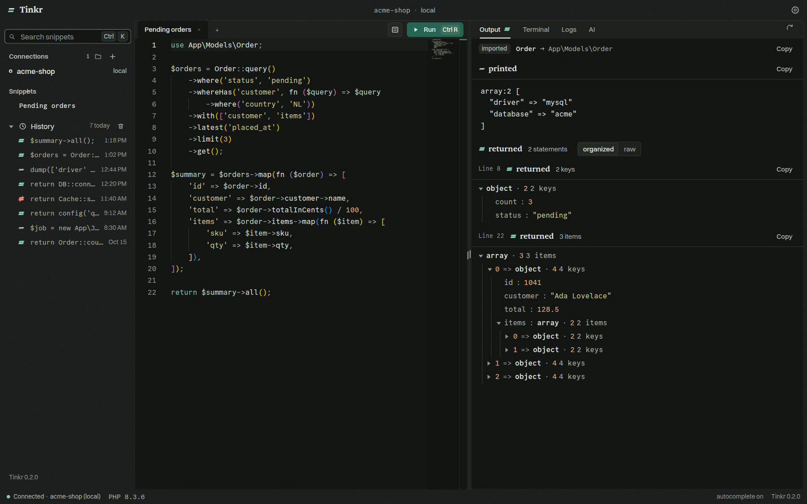
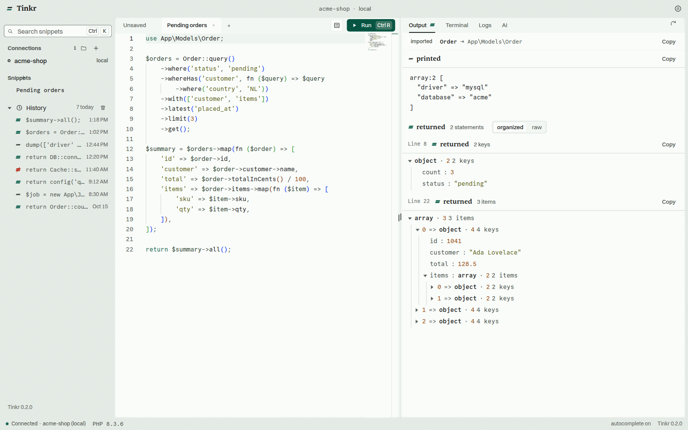
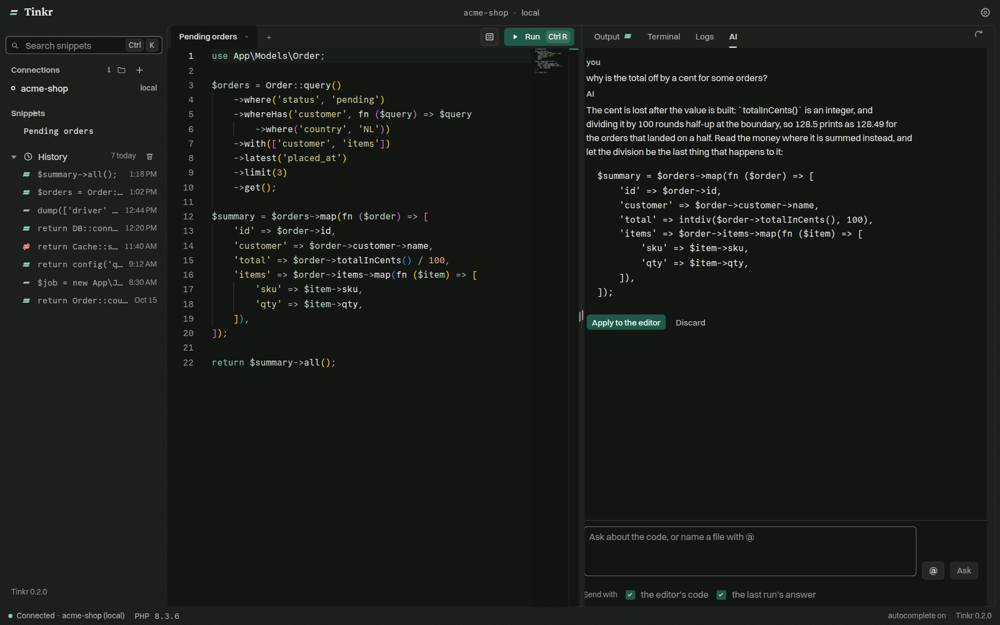

<p align="center">
  
</p>

<h1 align="center">Tinkr</h1>

<p align="center">
  <strong>Run the code. Read the answer.</strong>
</p>

<p align="center">
  A desktop runner for <a href="https://github.com/laravel/tinker">Laravel Tinker</a> and plain PHP.<br>
  Run a snippet in any project, on this machine or over SSH, and get back the <em>value</em> it returned,<br>
  not a wall of text it printed.
</p>

<p align="center">
  <a href="https://github.com/nurmohseni/tinkr/releases/latest"></a>
  <a href="https://github.com/nurmohseni/tinkr/releases"></a>
  
  <a href="https://modelcontextprotocol.io"></a>
  <a href="./LICENSE"></a>
</p>

<p align="center">
  <a href="https://tinkrapp.dev">Website</a> ·
  <a href="#install">Install</a> ·
  <a href="#features">Features</a> ·
  <a href="#mcp-server">MCP server</a> ·
  <a href="#development">Development</a> ·
  <a href="./CONTRIBUTING.md">Contributing</a>
</p>

<p align="center">
  
</p>

## Why Tinkr

`php artisan tinker` is the fastest way to ask your app a question, and the worst way to read the answer. Tinkr keeps the question and fixes the answer:

- **Values, not text.** A collection comes back as a table, a model as a tree, HTML as a rendered frame.
- **See what it cost.** Every query the run sent, with its bindings and timing.
- **Touch production without fear.** Run a write inside a transaction, look at what changed, then keep it or roll it back.
- **Always fresh.** Each run boots a new Tinker session, so the code on disk is the code that runs.

## Install

Grab the installer for your platform from the [latest release](https://github.com/nurmohseni/tinkr/releases/latest).

| Platform | Package |
| --- | --- |
| macOS (Apple silicon) | `.dmg` · `.zip` |
| Windows | `Tinkr.Setup.<version>.exe` |
| Linux | `.AppImage` · `.deb` · `.rpm` · `.tar.gz` |

You need `php` on the machine (or server) where your project lives. That's it.

If macOS says **Tinkr is damaged and can't be opened**, the release you took was
built without an Apple signing identity. Move `Tinkr.app` to `/Applications`, then
drop the flag macOS puts on a download it could not verify:

```bash
xattr -dr com.apple.quarantine /Applications/Tinkr.app
```

## Features

### Run

| | |
| --- | --- |
| **Connections** | Local projects; Docker, Podman, Sail and Kubernetes containers; any server over SSH, with a key or a password; a container on a server, which is what a Dokploy, Coolify or compose deploy is; a **Laravel Cloud** environment; and a **Laravel Vapor** environment. The container and the project inside it are picked from what is running rather than typed. A password is kept in a file only you can read, never shown back, and answered by the app itself. An SSH connection is logged in to once and then reused, so each run pays for the work and not for the handshake, and the classes a snippet names by their short name are read from that server's own project. Tag a connection as production and Tinkr asks before it writes. |
| **Laravel Cloud** | Paste an API token in **Settings → Laravel Cloud** and Tinkr checks it before keeping it. Then pick an application and one of its environments; the code runs inside that environment through Laravel Cloud's API, with the same readings, queries and dry runs as any other connection, and the run timeout travels with it, so the command ends itself at the deadline where the environment's PHP has pcntl. The token needs **Applications:** View applications and **Environments:** View environments, View environment instances, Create environment commands, View environment logs; everything else can stay at None. Point the connection at a local checkout of the same app if you want class names completed. Logs and live method completion are not available on Laravel Cloud. |
| **Laravel Vapor** | Paste an API token in **Settings → Laravel Vapor**, or use the login the Vapor CLI already has on this machine; Tinkr checks it before keeping it. Then pick a team, a project and one of its environments; the code runs in that environment as a Vapor CLI command, with the same readings, queries and dry runs as any other connection. Vapor's own runtime leaves out any printed line that looks like a JSON log record (`{"message":…,"level":…}`), so text printed on such a line does not reach Tinkr. Logs, live method completion and Explain are not available on Laravel Vapor. |
| **Editor** | Monaco, with a completion that knows your project: `User::` lists a model's statics and its builder's chain, `$user->` lists the table's columns in their order, a `$variable` knows what it was assigned from, and `config('`, `route('`, `view(`, `env(`, `trans(` and container bindings offer the names the project has — read from the running app, not guessed. Names come with the `use` statement they need and calls with the parameters they require. All of it is answered from a read kept in memory, so typing never waits for PHP; the status bar says how old the read is and reads the project again on a click, or by itself when a file changes. The signature of the call the caret is in is drawn as you type its arguments. Laravel Cloud connections answer from their local checkout. |
| **Snippet forms** | Turn a snippet's variables into a form and run it like a tiny admin panel. |
| **Snippets & history** | Save the code you reuse. Every run is kept across restarts; one click puts it back in the editor. |
| **Tabs, each with its own answer** | Open several snippets at once: every tab keeps the result it ran, its printed output and its own run marker, so switching back finds the answer it left rather than the last one anywhere. Each connection keeps its own tabs: move to another project and back, and the documents, the code in them and a run that was going are where you left them — the run is not stopped by the move, and its answer waits for the connection. |

What a run does with the code is worth knowing before the first one:

- A top-level `return` ends the snippet. Statements after it do not run, and what it returned is the run's value.
- A snippet runs once. Every statement is evaluated once rather than probed and retried, so a statement that prints, writes or sends does it once.
- A snippet is parsed before it runs. A syntax error anywhere in it — including inside a function or class declaration — answers with that parse error and executes nothing, which is what php does with a file. A last line without its `;` is still accepted.
- A top-level `use` statement is an import for the code after it, and an unconditional top-level `function` declaration is available to the whole snippet: both are compiled before php runs the first line, and the snippet behaves the same way.
- Values come back as they are: an object stays an object (an empty one is `{}`, not `[]`), a scalar stays a scalar, and a value JSON cannot carry — a resource, a recursive reference, an unsafe float — is described by a string such as `[resource: stream]`, `[recursion]` or `INF` rather than silently becoming `null` or `0`. An object is described after the snippet has ended, so a `jsonSerialize` that prints prints once and reads its final state, and the same object returned by several statements is serialized once.
- If the project's command exits while a run is going — tinker crashed, php was killed — the run ends with that exit status straight away instead of waiting out the run timeout.
- Reconnecting a **Laravel Cloud** or **Laravel Vapor** connection ends the wait on this side; the command ends itself at the run timeout where the environment's PHP has pcntl, and otherwise it keeps running there.

### Read

| | |
| --- | --- |
| **Readings** | The returned value as a tree, a table, a graph, or rendered markup, next to the raw output. The tree names what each value was: the class behind an object, a model's key and the relations it already had, a closure's signature, an enum's case. A view, a mailable or an `HtmlString` is offered as markup and drawn in a sandboxed frame that runs nothing. Copy any table or save it as CSV, or copy the whole run as Markdown — the code, every value, what it printed, what it dumped, its queries and its guard — for a pull request or an issue. |
| **Time and memory** | The run's head says what the snippet itself spent: its own PHP time and the memory it peaked at, measured inside the session rather than guessed at from the window. The wall clock — the session's boot included — is the tooltip on the same figure, and the status bar carries it too. |
| **Dumps** | `dump()` and `dd()` answer with the value itself, not only with the text the dumper printed: each dump is a tree of its own under the line it was dumped from, and a `dd()` or an `exit()` ends the run as an ending — `ended` on line *n* — and never as a failure. |
| **Statements** | A run of several statements is read one statement at a time: each is numbered, and its own head stays over its value while that value scrolls, so a long tree never loses the line it belongs to. A long run also gets a map of its statements above them, with the ones that threw struck through and every key leading to its statement; **Failed only** in the run's head narrows the run to the statements that threw. |
| **Queries** | Every SQL statement the run sent, with bindings, duration and connection. A SELECT also offers **Explain**: its plan is read out of band on the same connection and with the same bindings, never in the tab's session and never as a history entry. A write offers no plan, and Laravel Cloud and Laravel Vapor show the action disabled because a command there would land in the environment's history. |
| **Hidden fields** | Password, token, secret and key-shaped fields are written as `[hidden]` in the saved history, in AI requests and in MCP answers. Set their names in **Settings → General**. The result pane and what the code printed stay as they ran. |
| **Dry run** | Run inside a transaction you can keep or take back, or a sandboxed one where mail, jobs, HTTP calls, file writes, the cache and the log are recorded instead of happening. A guarded run also answers with what it changed, row by row — the table, the key, and each column before → after — and counts the writes nothing could describe (raw SQL, a query-builder update, `truncate`). |
| **Stop** | A run that is going can be stopped, and the PHP behind it actually stops — inside a container or on a server. Laravel Cloud cannot cancel a command it was given, so stopping a Cloud run ends the wait and says the command keeps running there. A run also gives up on its own after the **run timeout** you set in Settings, so a snippet that never returns cannot hold the session; on Laravel Cloud that deadline ends the command too where the environment's PHP has pcntl, and otherwise the command keeps running there. While a run is going the editor is read-only, the button counts the wait, and the answer reports how long the whole of it took. |
| **Log viewer** | Your app's logs (`storage/logs` or anywhere) in a window of their own. Level, text and time filters search the file, not just loaded pages. Scroll in either direction with your place preserved and only a bounded window held; messages and stack traces stay together across pages. Follow live, including details that arrive after an entry's header. |

Log searches scan the selected file or time range on the connection's host. They can take longer than ordinary paging on a large file, but only matching entries are returned. Changing the file or filters supersedes pending reads; reversing direction discards a pending page rather than evicting what you returned to.

### Ask

| | |
| --- | --- |
| **AI completions** | Complete snippets with OpenAI, Claude, Ollama, OpenRouter, OpenCode Zen/Go, or your own endpoint. |
| **AI panel** | Ask about the code in front of you. The last result goes along, `@` pulls in project files, and proposed code drops into the editor. An answer is read as it was written — paragraphs, lists and code — and the snippet it proposes is shown in the editor's own colours, with the lines kept as they were. |
| **MCP server** | Let Claude Code, Cursor, VS Code and friends run code through the same connections you use. |

<table>
  <tr>
    <td width="50%"></td>
    <td width="50%"></td>
  </tr>
  <tr>
    <td align="center"><sub>Dark and light, one palette across the whole app</sub></td>
    <td align="center"><sub>The AI panel, with your last result as context</sub></td>
  </tr>
</table>

## MCP server

Tinkr ships a [Model Context Protocol](https://modelcontextprotocol.io) server, so the AI tool you already work in can run PHP the way you do: in your project's own Tinker session, locally or over SSH, with the returned value as data.

**The easy way:** open **Settings → MCP**. Tinkr lists the clients it knows (Claude Code, Claude Desktop, Cursor, Windsurf/Devin Desktop, VS Code), writes the config for the one you pick, and gives you the JSON for anything else.

The same screen lists every **session** a client had with the server, newest first: the client's name and version, the connections its calls went to, and each tool it called with its code, guard, outcome and duration. A session that is still connected says so and updates while the screen is open. The last 100 sessions are kept, and **Clear** forgets the ones that ended. A call that ran in a connection the app still has offers **Open in editor**: the editor window switches to that connection and opens the code in a new tab — nothing is run. A call that ran in a bare directory, or in a connection that was deleted, says so instead.

**By hand:**

```json
{
  "mcpServers": {
    "tinkr": {
      "command": "node",
      "args": ["/path/to/tinkr/packages/tinkr-mcp/src/cli.js"]
    }
  }
}
```

The directory the client starts it in is the project code runs in. No API token, no open window needed.

<details>
<summary><strong>Tools</strong></summary>

| Tool | What it does |
| --- | --- |
| `tinkr_documentation` | How Tinkr works and how to use these tools: the guards, connections, every tool, how to read an answer |
| `tinkr_run_php` | Run PHP in a local project, a Laravel Cloud environment or a Laravel Vapor environment: what every statement returned, and what the code printed |
| `tinkr_run_php_over_ssh` | The same, on a server, through one of Tinkr's SSH connections |
| `tinkr_list_history` | The runs the app kept for a connection: the code, when it ran, how it ended |
| `tinkr_read_run` | One kept run in full: what it returned, printed and threw |
| `tinkr_list_logs` | The log files of a connection, newest first: name, size, when it was last written |
| `tinkr_tail_logs` | A connection's logs: the newest window of a file, or the entries that match a level or a term |
| `tinkr_list_connections` | The connections saved in the app, with the command each session starts with |
| `tinkr_list_snippets` | The snippets saved for a connection |
| `tinkr_save_snippet` | Keep code as a snippet of a connection |
| `tinkr_delete_snippet` | Delete a snippet by its id |

History is the app's own: the last fifty runs of a connection. A client's own runs are not written to it, because the app owns that file while it runs.

**Hidden fields.** Every answer is masked before it leaves the app: a field whose name matches an entry in **Settings → General → Hidden fields** is answered as the string `[hidden]`, in the text and the structured value alike. The same applies to the history the app keeps on disk and to what the AI panel sends with a request; the result pane is the one place the value is shown as it ran. The defaults are `*password*`, `*token*`, `*secret*`, `api_key`, `*_key`, `*authorization*` and `cookie` — `*` matches any run of characters, case does not matter, and an empty list hides nothing. The list is read on every MCP call, so a change holds from the next one.

Covered:

- the run's `value`, and the same value under every `blocks[].value`;
- a dry run's `transaction` report, including each `changes[].before`, `changes[].after` and `changes[].key` row, and the `sandbox` report;
- query bindings, where the SQL names the column the placeholder was given for: an `insert`'s column list against its `values`, `column = ?` in a `set` or a `where` (also `<>`, `!=`, `<`, `>`, `<=`, `>=` and `like`), and `column in (?, …)`;
- an array of models, a nested object or a whole list under a matching key — the value is replaced whole;
- MCP answers of `tinkr_run_php`, `tinkr_run_php_over_ssh`, `tinkr_read_run`, and the entries `tinkr_list_history` reads.

Not covered, by design:

- `output`, what the code printed: it is text, not keyed, and there is no field name to match;
- SQL text itself. A value a snippet wrote into the statement (`where token = 'abc'`) is part of the SQL and is answered as it was, and so is the sample of un-diffed statements a dry run reports;
- the lines a sandbox would have sent or requested, which are text rather than fields;
- a binding the statement does not pair with a column: `where ?`, `limit ?`, and an expression holding several placeholders such as `concat(?, ?)`;
- the result pane, and the run as the app's window holds it in memory.


`tinkr_run_php` and `tinkr_run_php_over_ssh` take an optional `guard`:

- **`rollback`** runs the code inside a transaction that is taken back at the end, and reports what that transaction did — the safe way for an agent to look at production without changing it. The report includes `transaction.changes`: one entry per row the run created, updated or deleted, with the key, the operation and the columns either side of it, plus `transaction.undiffed` for writes nothing could attribute to a row.
- **`sandbox`** is the same transaction with the side-effect drivers swapped for recorders first: mail goes to the array transport, jobs and the bus to their fakes, the HTTP client answers only what it was given, every disk is faked, the cache is an array store and logging records instead of writing. A write that was rolled back cannot still have sent an email. The answer carries what was caught — a count per channel with the first mail and requests named.

A transaction holds the database and nothing else, so `sandbox` is the guard to name when the code might send, queue, call or write something.

**`tinkr_documentation`** is the same for a model: it answers with what the app is, what each guard holds and when to use which, what a connection is and what the production tag changes, every tool, and how to read the envelope. A model that reads it before running anything needs no prior knowledge of Tinkr.

`tinkr_tail_logs` reads a log without holding it: a window of the newest bytes by default, `before`/`after` for the pages beside it, and `since`/`until` for a range of moments found in the file itself. A `level` or a `term` turns the read into a scan of the whole range, answering with the newest `limit` matches — so an error far back in a large log is still found. Reading logs is allowed on any connection, production included: it reads a file.

A connection tagged **production** follows the **Production connections** mode in **Settings → MCP**, and each production connection can override it with an access of its own. **Refuse** (the default) stops the run before anything is booted; **Sandbox** lets it through, always with `guard: "sandbox"` — mail, jobs, HTTP calls, file writes, the cache and the log recorded, the database rolled back — and refuses code a dry run cannot take back (DDL, its own commit, another connection) with the lines and the reasons; **Allow** sends it as asked. Both the mode and a connection's override are read on every run, so a change holds from the next call without restarting the client, and a forced guard is said plainly in the answer and shown as forced in **Settings → MCP → Sessions**. Reading logs is allowed either way.

</details>

<details>
<summary><strong>Options</strong></summary>

| Option | What it is |
| --- | --- |
| `--connection <id\|name>` | Run in a connection the app knows, by id or name |
| `--path <directory>` | The project to run in (default: where the client started it) |
| `--command <command>` | What the session starts with (default: the connection's own, or `php artisan tinker`) |
| `--data-dir <directory>` | Where the app keeps its connections and snippets, if not the default |
| `--timeout <ms>` | How long a run may take before it is given up (default: `60000`) |

Try it from a terminal to see what a tool answers:

```sh
yarn mcp --path /path/to/your/project
```

When Tinkr has a connection for that directory, the server uses it, so snippets and history are shared with the app. A packaged app carries its own copy of the server outside the asar, where plain `node` can read it. An **AppImage** is mounted under a temporary directory that goes away when the app closes, so on that build the settings screen points clients at a copy in the app's own data directory, which survives both a restart and an update.

A run whose command never boots — no `artisan` in the directory, a platform check that refuses the php — answers as soon as the command exits, with what it printed and the status it left, instead of waiting out the timeout.

</details>

## Development

```sh
git clone https://github.com/nurmohseni/tinkr.git
cd tinkr
yarn
yarn start
```

`yarn start` fetches the interface fonts (Switzer and Sentient from Fontshare, not redistributable) and starts the main and renderer processes. Offline, it falls back to system fonts. See [CONTRIBUTING.md](./CONTRIBUTING.md) for the rest.

### Tests

```sh
yarn test    # unit and component tests, in every package
yarn e2e     # end-to-end: Playwright launches the real app and drives it
```

The end-to-end suite runs the real main process, preload bridge and renderer,
with a real pty behind every run, against a small tinker-compatible project in
`e2e/fixtures/app`. Every test gets a throwaway profile. Container and SSH
flows run where Docker or a local sshd is available. [e2e/README.md](./e2e/README.md)
has the coverage and the details; [`.github/workflows/tests.yml`](./.github/workflows/tests.yml)
runs both suites on every push and pull request.

<details>
<summary><strong>Tech stack</strong></summary>

A Yarn workspaces monorepo on [Electron](https://www.electronjs.org/).

| Layer | Built with |
| --- | --- |
| Renderer | [React](https://react.dev/), [Vite](https://vitejs.dev/), [jotai](https://github.com/pmndrs/jotai), [Immer](https://immerjs.github.io/immer/), [Monaco Editor](https://microsoft.github.io/monaco-editor/), [xterm.js](https://xtermjs.org/), [wouter](https://github.com/molefrog/wouter), [React Hook Form](https://react-hook-form.com/), [React Intl](https://formatjs.io/docs/react-intl/) |
| Main | [node-pty](https://github.com/microsoft/node-pty), [electron-store](https://github.com/sindresorhus/electron-store), [ncc](https://github.com/vercel/ncc) |
| Design | One system in [`design.md`](./design.md); tokens in `packages/tinkr-renderer/public/tinkr.css`. Type: Switzer, Sentient, Commit Mono |

</details>

## Contributing

Bug reports, ideas and pull requests are welcome. Start with [CONTRIBUTING.md](./CONTRIBUTING.md), or [open an issue](https://github.com/nurmohseni/tinkr/issues).

## License

[MIT](./LICENSE)
