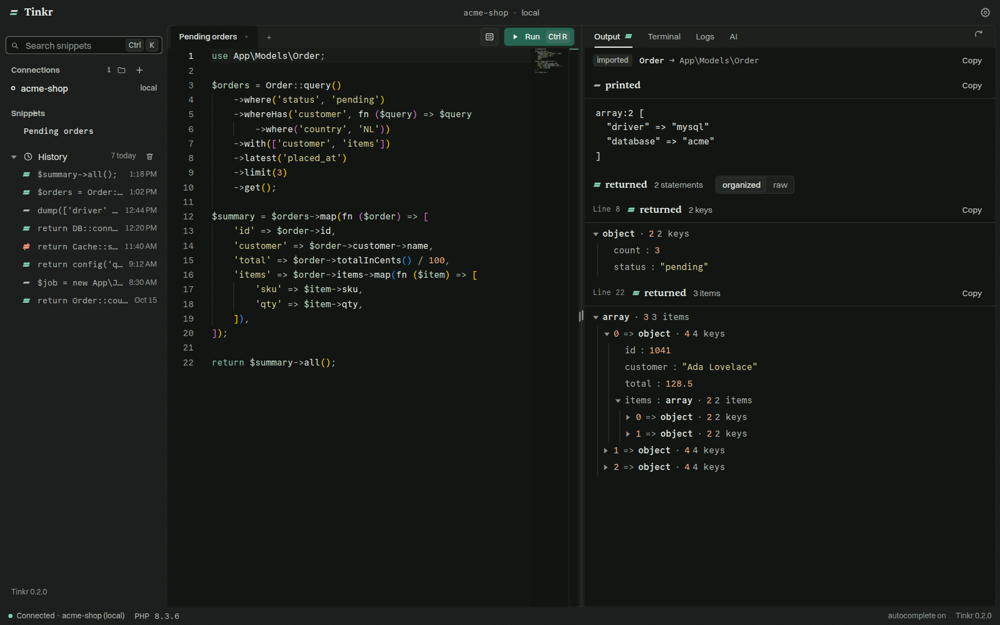
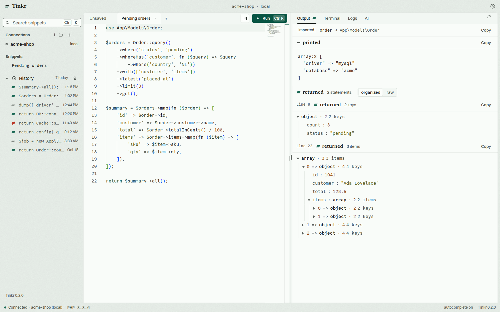
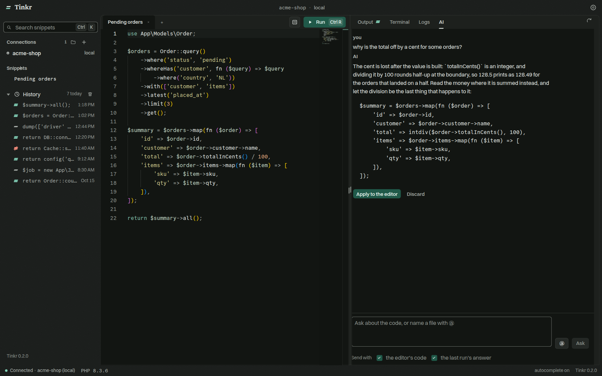

<p align="center">
  
</p>

<h1 align="center">Tinkr</h1>

<p align="center">
  <strong>Run the code. Read the answer.</strong>
</p>

<p align="center">
  A desktop runner for <a href="https://github.com/laravel/tinker">Laravel Tinker</a> and plain PHP.<br>
  Run a snippet in any project, on this machine or over SSH, and get back the <em>value</em> it returned,<br>
  not a wall of text it printed.
</p>

<p align="center">
  <a href="https://github.com/nurmohseni/tinkr/releases/latest"></a>
  <a href="https://github.com/nurmohseni/tinkr/releases"></a>
  
  <a href="https://modelcontextprotocol.io"></a>
  <a href="./LICENSE"></a>
</p>

<p align="center">
  <a href="#install">Install</a> ·
  <a href="#features">Features</a> ·
  <a href="#mcp-server">MCP server</a> ·
  <a href="#development">Development</a> ·
  <a href="./CONTRIBUTING.md">Contributing</a>
</p>

<p align="center">
  
</p>

## Why Tinkr

`php artisan tinker` is the fastest way to ask your app a question, and the worst way to read the answer. Tinkr keeps the question and fixes the answer:

- **Values, not text.** A collection comes back as a table, a model as a tree, HTML as a rendered frame.
- **See what it cost.** Every query the run sent, with its bindings and timing.
- **Touch production without fear.** Run a write inside a transaction, look at what changed, then keep it or roll it back.
- **Always fresh.** Each run boots a new Tinker session, so the code on disk is the code that runs.

## Install

Grab the installer for your platform from the [latest release](https://github.com/nurmohseni/tinkr/releases/latest).

| Platform | Package |
| --- | --- |
| macOS (Apple silicon) | `.dmg` · `.zip` |
| Windows | `Tinkr.Setup.<version>.exe` |
| Linux | `.AppImage` · `.deb` · `.rpm` · `.tar.gz` |

You need `php` on the machine (or server) where your project lives. That's it.

## Features

### Run

| | |
| --- | --- |
| **Connections** | Local projects; Docker, Podman, Sail and Kubernetes containers; any server over SSH, with a key or a password; and a container on a server, which is what a Dokploy, Coolify or compose deploy is. The container and the project inside it are picked from what is running rather than typed. A password is kept in a file only you can read, never shown back, and answered by the app itself. Tag a connection as production and Tinkr asks before it writes. |
| **Editor** | Monaco, with class names and `::` method suggestions read straight from your project, local or remote. |
| **Snippet forms** | Turn a snippet's variables into a form and run it like a tiny admin panel. |
| **Snippets & history** | Save the code you reuse. Every run is kept across restarts; one click puts it back in the editor. |
| **Tabs, each with its own answer** | Open several snippets at once: every tab keeps the result it ran, its printed output and its own run marker, so switching back finds the answer it left rather than the last one anywhere. |

### Read

| | |
| --- | --- |
| **Readings** | The returned value as a tree, a table, a graph, or rendered markup, next to the raw output. Copy any table or save it as CSV. |
| **Queries** | Every SQL statement the run sent, with bindings, duration and connection. |
| **Dry run** | Run inside a transaction you can keep or take back, or a sandboxed one where mail, jobs, HTTP calls, file writes, the cache and the log are recorded instead of happening. |
| **Stop** | A run that is going can be stopped, and the PHP behind it actually stops — inside a container or on a server. It also gives up on its own after the **run timeout** you set in Settings, so a snippet that never returns cannot hold the session. While a run is going the editor is read-only, the button counts the wait, and the answer reports how long the whole of it took. |
| **Log viewer** | Your app's logs (`storage/logs` or anywhere) in a window of their own, so the editor keeps its width. Filter by any of monolog's eight levels, by a term, and by a span of time. Follow a file live, or step back through it a window at a time. |

### Ask

| | |
| --- | --- |
| **AI completions** | Complete snippets with OpenAI, Claude, Ollama, OpenRouter, OpenCode Zen/Go, or your own endpoint. |
| **AI panel** | Ask about the code in front of you. The last result goes along, `@` pulls in project files, and proposed code drops into the editor. |
| **MCP server** | Let Claude Code, Cursor, VS Code and friends run code through the same connections you use. |

<table>
  <tr>
    <td width="50%"></td>
    <td width="50%"></td>
  </tr>
  <tr>
    <td align="center"><sub>Dark and light, one palette across the whole app</sub></td>
    <td align="center"><sub>The AI panel, with your last result as context</sub></td>
  </tr>
</table>

## MCP server

Tinkr ships a [Model Context Protocol](https://modelcontextprotocol.io) server, so the AI tool you already work in can run PHP the way you do: in your project's own Tinker session, locally or over SSH, with the returned value as data.

**The easy way:** open **Settings → MCP**. Tinkr lists the clients it knows (Claude Code, Claude Desktop, Cursor, Windsurf/Devin Desktop, VS Code), writes the config for the one you pick, and gives you the JSON for anything else.

**By hand:**

```json
{
  "mcpServers": {
    "tinkr": {
      "command": "node",
      "args": ["/path/to/tinkr/packages/tinkr-mcp/src/cli.js"]
    }
  }
}
```

The directory the client starts it in is the project code runs in. No API token, no open window needed.

<details>
<summary><strong>Tools</strong></summary>

| Tool | What it does |
| --- | --- |
| `tinkr_documentation` | How Tinkr works and how to use these tools: the guards, connections, every tool, how to read an answer |
| `tinkr_run_php` | Run PHP in a local project: what every statement returned, and what the code printed |
| `tinkr_run_php_over_ssh` | The same, on a server, through one of Tinkr's SSH connections |
| `tinkr_list_history` | The runs the app kept for a connection: the code, when it ran, how it ended |
| `tinkr_read_run` | One kept run in full: what it returned, printed and threw |
| `tinkr_list_connections` | The connections saved in the app, with the command each session starts with |
| `tinkr_list_snippets` | The snippets saved for a connection |
| `tinkr_save_snippet` | Keep code as a snippet of a connection |
| `tinkr_delete_snippet` | Delete a snippet by its id |

History is the app's own: the last fifty runs of a connection. A client's own runs are not written to it, because the app owns that file while it runs.

`tinkr_run_php` and `tinkr_run_php_over_ssh` take an optional `guard`:

- **`rollback`** runs the code inside a transaction that is taken back at the end, and reports what that transaction did — the safe way for an agent to look at production without changing it.
- **`sandbox`** is the same transaction with the side-effect drivers swapped for recorders first: mail goes to the array transport, jobs and the bus to their fakes, the HTTP client answers only what it was given, every disk is faked, the cache is an array store and logging records instead of writing. A write that was rolled back cannot still have sent an email. The answer carries what was caught — a count per channel with the first mail and requests named.

A transaction holds the database and nothing else, so `sandbox` is the guard to name when the code might send, queue, call or write something.

**`tinkr_documentation`** is the same for a model: it answers with what the app is, what each guard holds and when to use which, what a connection is and what the production tag changes, every tool, and how to read the envelope. A model that reads it before running anything needs no prior knowledge of Tinkr.

A connection tagged **production** is refused unless the server was started on that connection (`--connection`) or with `--allow-production`. A run there is a write nobody is watching.

</details>

<details>
<summary><strong>Options</strong></summary>

| Option | What it is |
| --- | --- |
| `--connection <id\|name>` | Run in a connection the app knows, by id or name |
| `--path <directory>` | The project to run in (default: where the client started it) |
| `--command <command>` | What the session starts with (default: the connection's own, or `php artisan tinker`) |
| `--data-dir <directory>` | Where the app keeps its connections and snippets, if not the default |
| `--timeout <ms>` | How long a run may take before it is given up (default: `60000`) |
| `--allow-production` | Run code on connections tagged production. Without it, a production connection is refused unless the server was started on that one connection with `--connection` |

Try it from a terminal to see what a tool answers:

```sh
yarn mcp --path /path/to/your/project
```

When Tinkr has a connection for that directory, the server uses it, so snippets and history are shared with the app. A packaged app carries its own copy of the server outside the asar, where plain `node` can read it. An **AppImage** is mounted under a temporary directory that goes away when the app closes, so on that build the settings screen points clients at a copy in the app's own data directory, which survives both a restart and an update.

A run whose command never boots — no `artisan` in the directory, a platform check that refuses the php — answers as soon as the command exits, with what it printed and the status it left, instead of waiting out the timeout.

</details>

## Development

```sh
git clone https://github.com/nurmohseni/tinkr.git
cd tinkr
yarn
yarn start
```

`yarn start` fetches the interface fonts (Switzer and Sentient from Fontshare, not redistributable) and starts the main and renderer processes. Offline, it falls back to system fonts. See [CONTRIBUTING.md](./CONTRIBUTING.md) for the rest.

<details>
<summary><strong>Tech stack</strong></summary>

A Yarn workspaces monorepo on [Electron](https://www.electronjs.org/).

| Layer | Built with |
| --- | --- |
| Renderer | [React](https://react.dev/), [Vite](https://vitejs.dev/), [jotai](https://github.com/pmndrs/jotai), [Immer](https://immerjs.github.io/immer/), [Monaco Editor](https://microsoft.github.io/monaco-editor/), [xterm.js](https://xtermjs.org/), [wouter](https://github.com/molefrog/wouter), [React Hook Form](https://react-hook-form.com/), [React Intl](https://formatjs.io/docs/react-intl/) |
| Main | [node-pty](https://github.com/microsoft/node-pty), [electron-store](https://github.com/sindresorhus/electron-store), [ncc](https://github.com/vercel/ncc) |
| Design | One system in [`design.md`](./design.md); tokens in `packages/tinkr-renderer/public/tinkr.css`. Type: Switzer, Sentient, Commit Mono |

</details>

## Contributing

Bug reports, ideas and pull requests are welcome. Start with [CONTRIBUTING.md](./CONTRIBUTING.md), or [open an issue](https://github.com/nurmohseni/tinkr/issues).

## License

[MIT](./LICENSE)
